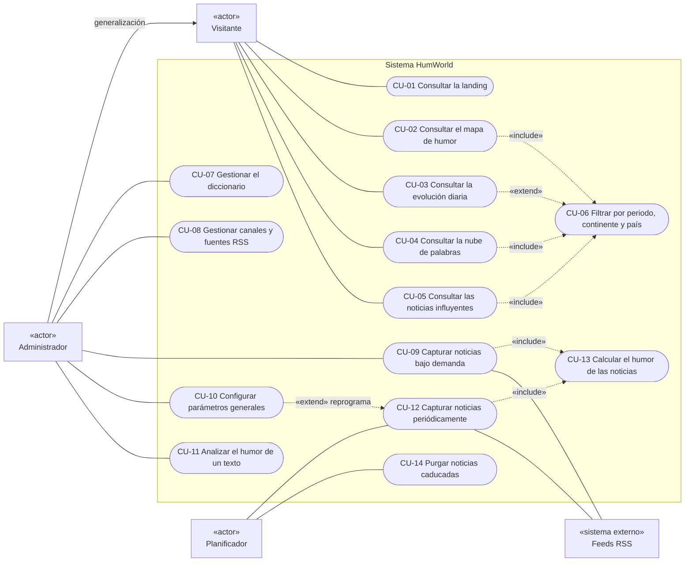

# UML-01 — Diagrama de casos de uso

| Campo | Valor |
|---|---|
| **Identificador** | `UML-01` |
| **Épica / Sprint** | Transversal — Sprint 3 (`DOC-S3`) |
| **Responsable** | Matías Santos (Arquitectura y Documentación) |
| **Depende de** | `T-DASH-01`, `E3-H01`, `ADR-000`, `ADR-002` |
| **Estado** | Publicado — refleja `main` en `bc43219` (16 de octubre de 2026) |
| **Fecha** | 2026-10-19 |
| **Fuente** | Especificación HumWorld 260714, secc. 4.2, 4.3, 4.7 (punto 3) y 10.2; `backend/app/api/`; `frontend/src/App.tsx` |

---

## 1. Alcance

Describe qué puede hacer cada actor con HumWorld según el código integrado en `main`, no según el backlog previsto. Cada caso de uso se traza a su historia y a su endpoint o ruta real.

Fuera de alcance: la carga inicial de fuentes (`E1-H02`), porque es un script de despliegue (`python -m app.seeds.sources`) y no una interacción con el sistema; y la autenticación, que no existe por diseño (restricción `R-03`).

---

## 2. Actores

| Actor | Tipo | Descripción |
|---|---|---|
| **Visitante** | Principal, humano | Cualquier persona que abre la aplicación. Consulta la landing y el dashboard. |
| **Administrador** | Principal, humano | Mantiene el diccionario, las fuentes RSS y los parámetros. No se autentica: los endpoints de administración están abiertos por diseño (`R-03`). Hereda los casos de uso del Visitante. |
| **Planificador** | Secundario, de tiempo | Scheduler de APScheduler en `backend/app/scheduler.py`. Dispara los trabajos `rss-news-capture` y `news-purging` cada `captura_periodicidad_minutos`. |
| **Feeds RSS** | Secundario, sistema externo | Feeds de los medios registrados. Solo se leen por RSS; no hay *scraping*. |

---

## 3. Diagrama

Mermaid no tiene un diagrama de casos de uso UML nativo; se representa con un `flowchart LR`, con los actores fuera y los casos de uso dentro del subgrafo que marca el límite del sistema.

> `CU-03` extiende a `CU-06` y no lo incluye: `GET /dashboards/evolucion` admite el filtro, pero si no recibe fechas usa los últimos 30 días.

---

## 4. Casos de uso

| ID | Nombre | Actor | Historia | Endpoint / ruta |
|---|---|---|---|---|
| CU-01 | Consultar la landing | Visitante | — (trabajo fuera de backlog, PR #48-#50, #56, #57, #65) | Ruta `/`; no consume la API (datos de ejemplo) |
| CU-02 | Consultar el mapa de humor por continente y país | Visitante | `E3-H01`, `T-DASH-01` | Ruta `/dashboard`; `GET /api/v1/dashboards/geografia`, `GET /api/v1/dashboards` |
| CU-03 | Consultar la evolución diaria y elegir el día | Visitante | `E3-H01` | Ruta `/dashboard`; `GET /api/v1/dashboards/evolucion` |
| CU-04 | Consultar la nube de palabras | Visitante | `E3-H03`, `T-DASH-01` | Ruta `/dashboard`; `GET /api/v1/dashboards/nube-palabras` |
| CU-05 | Consultar las noticias influyentes | Visitante | `E3-H02` (criterio en `ADR-002`) | Ruta `/dashboard`; `GET /api/v1/dashboards/noticias-influyentes` |
| CU-06 | Filtrar por periodo, continente y país | Visitante | `T-DASH-01` | Parámetros `fecha_desde`, `fecha_hasta`, `continente`, `pais` |
| CU-07 | Gestionar el diccionario de términos | Administrador | `E2-H01-API`, `E2-H01-UI` | Ruta `/dictionary`; `GET`, `POST /api/v1/dictionary`; `GET`, `PUT`, `PATCH`, `DELETE /api/v1/dictionary/{term_id}` |
| CU-08 | Gestionar canales y fuentes RSS | Administrador | `E1-H01`, `E4-H04` | Ruta `/fuentes`; `GET`, `POST /api/v1/sources`; `GET`, `PUT`, `PATCH`, `DELETE /api/v1/sources/{source_id}`; `GET /api/v1/channels`; `GET`, `PUT`, `PATCH`, `DELETE /api/v1/channels/{channel_id}` |
| CU-09 | Capturar noticias bajo demanda | Administrador | `E1-H05` | Ruta `/fuentes`; `POST /api/v1/sources/capture` |
| CU-10 | Configurar parámetros generales | Administrador | `E1-H04`, `E4-H01`, `E4-H04` | Ruta `/parametros`; `GET`, `PUT /api/v1/config` |
| CU-11 | Analizar el humor de un texto puntual | Administrador | `E2-H04` | `POST /api/v1/sentiment` (solo API; sin persistencia) |
| CU-12 | Capturar noticias periódicamente | Planificador | `E1-H03` | Trabajo `rss-news-capture` |
| CU-13 | Calcular el humor de las noticias | — (incluido) | `E2-H02`, `E2-H03` (algoritmo en `ADR-001`) | `NewsCaptureService._analyze_news` y `process_pending_news` |
| CU-14 | Purgar noticias caducadas | Planificador | `E4-H02` | Trabajo `news-purging` (retención `noticias_caducidad_dias`) |
| CU-14 (manual) | Purgar noticias caducadas bajo demanda | Administrador | `E4-H03` | Ruta `/parametros`; `DELETE /api/v1/news` |

---

## 5. Notas por caso de uso

- **CU-02 a CU-06.** Las cuatro vistas del dashboard se cargan juntas desde `useDashboard` (`frontend/src/features/dashboard/application/`). El periodo es obligatorio salvo en `CU-03`; `pais` exige `continente`. Un filtro inválido devuelve `400`.
- **CU-05.** El criterio y el límite de 10 los fija `ADR-002` y los aplica `DashboardRepository.influential_news`. `E3-H02` no formaba parte del Sprint 3; el caso de uso existe porque el código ya está en `main` (PR #66).
- **CU-07.** `DELETE` desactiva el término, no lo borra (regla R-M6 de `MOD-01`).
- **CU-08.** `POST /api/v1/sources` crea un canal con sus fuentes o agrega fuentes a un canal existente. `DELETE /api/v1/channels/{channel_id}` desactiva el canal.
- **CU-10.** `PUT /api/v1/config` reprograma en caliente los dos trabajos del Planificador; por eso se dibuja como extensión de `CU-12`.
- **CU-09 y CU-12.** Ambas capturas analizan las noticias recién insertadas (`CU-13`). El trabajo periódico además recupera las pendientes con `process_pending_news()`.

---

## 6. Trazabilidad con los endpoints mínimos (Especificación, secc. 10.2)

| Grupo | Casos de uso | Estado en `main` |
|---|---|---|
| `/sources` | CU-08, CU-09 | Implementado |
| `/dictionary` | CU-07 | Implementado |
| `/config` | CU-10 | Implementado |
| `/sentiment` | CU-11 | Implementado solo `POST` |
| `/dashboards` | CU-02 a CU-06 | Implementado |
| `/news` | — | Sin endpoint propio. El listado de noticias influyentes vive en `/dashboards/noticias-influyentes` y el purgado automático es un trabajo interno y el manual se lanza desde `/parametros` |

---

*Documento UML-01 — Proyecto HumWorld, Universidad Andrés Bello, curso Uso de IA en Ingeniería de Software 2026-27.*
