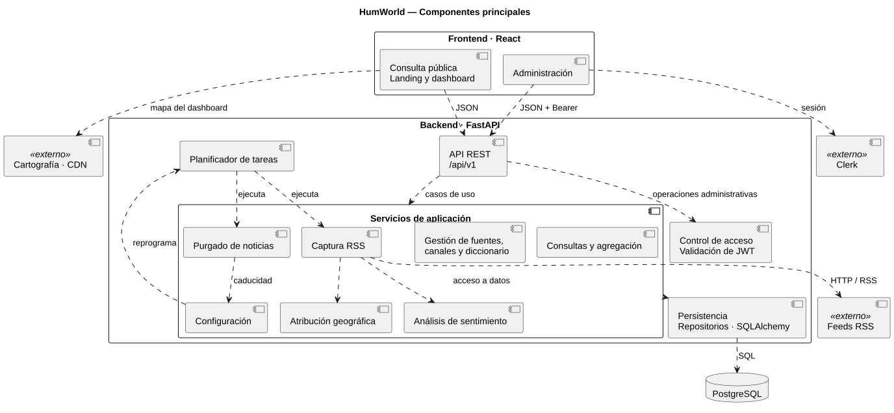

# UML-02 — Diagrama de componentes

| Campo | Valor |
|---|---|
| **Identificador** | `UML-02` |
| **Responsable** | Matías Santos (Arquitectura y Documentación) |
| **Estado** | Actualizado según la implementación del repositorio |
| **Fecha de revisión** | 2026-11-26 |
| **Referencias** | `ADR-000`, `ADR-001`, `ADR-002`, `ADR-003`, `ADR-004`, `MOD-01` |
| **Fuente** | `frontend/src/`, `backend/app/`, `opsx/docker-compose.yml` |

## 1. Alcance

Vista lógica de los componentes principales de HumWorld, agrupados por responsabilidad. Las agrupaciones corresponden al código actual; no representan microservicios ni unidades de despliegue independientes. El frontend consume una API y el backend reúne los servicios de aplicación, el planificador y el acceso a datos.

Se omiten archivos de arranque, layouts, hooks, protocolos Python, funciones, migraciones y tareas de carga inicial. El modelo de datos está en [MOD-01](MOD-01-modelo-er-inicial.md); los flujos de usuario, en [UML-01](UML-01-casos-de-uso.md). Puertos, variables de entorno y contenedores se documentan en [opsx](../../opsx/README.md).

## 2. Diagrama



Fuente editable: [PlantUML](UML-02-diagrama-componentes.puml). Regenerar el SVG con:

```bash
plantuml -charset UTF-8 -tsvg docs/uml/UML-02-diagrama-componentes.puml
```

Los rectángulos con icono UML representan componentes; los contenedores agrupan sus partes. Las flechas discontinuas indican dependencia, desde el consumidor hacia el componente utilizado. Se muestran las dependencias principales; la flecha de Servicios de aplicación a Persistencia resume el acceso a datos de sus servicios.

## 3. Responsabilidades y correspondencia con el código

| Componente | Responsabilidad | Implementación principal |
|---|---|---|
| Consulta pública | Landing y dashboard; mapa, evolución, nube de palabras, noticias influyentes y desglose de términos. | `frontend/src/features/landing`, `features/dashboard`, `pages/Dashboard` |
| Administración | Gestión de fuentes, canales, diccionario y parámetros; captura y purgado manuales. Integra la sesión Clerk y envía el token a la API. | `frontend/src/features/auth`, `features/sources`, `features/dictionary`, `features/config`, `pages/` |
| API REST | Publica los casos de uso, valida las solicitudes y serializa las respuestas. | `backend/app/api/`, `main.py` |
| Control de acceso | Valida los tokens de sesión para las operaciones administrativas. | `backend/app/auth.py` |
| Consultas y agregación | Consulta los agregados, la evolución, los términos influyentes, el ranking y el desglose de noticias. | `services/dashboards.py` |
| Gestión de fuentes, canales y diccionario | Aplica las reglas de administración de estos recursos. | `services/sources.py`, `channels.py`, `dictionary.py` |
| Configuración | Gestiona periodicidad y caducidad; resuelve los parámetros de sentimiento. El cambio de periodicidad reprograma las tareas. | `services/configuration.py`, `sentiment_configuration.py` |
| Captura RSS | Descarga y lee feeds; coordina el análisis y la atribución geográfica, y persiste los resultados. | `services/capture.py`, incluido `HttpxFeedparserClient` |
| Análisis de sentimiento | Reconoce términos y calcula el humor; incluye el análisis puntual y el motor utilizado durante la captura. | `services/sentiment_analysis.py`, `sentiment_engine.py` |
| Atribución geográfica | Reconoce países mediante un catálogo local de aliases. | `services/geographic_attribution.py` |
| Purgado de noticias | Elimina noticias según la caducidad configurada, mediante ejecución manual o programada. | `services/purging.py`, incluidos sus servicios de aplicación y dominio |
| Planificador de tareas | Ejecuta periódicamente captura y purgado. | `scheduler.py` (`CaptureScheduler`, APScheduler) |
| Persistencia | Agrupa repositorios, modelos ORM, motor y sesiones de base de datos. | `repositories/`, `models/`, `database.py` |
| PostgreSQL | Almacena noticias, términos, fuentes, configuración y atribuciones geográficas. | Modelos y migraciones de `backend/` |
| Clerk | Proveedor externo de identidad y sesiones administrativas. | Integración en `features/auth` y verificador en `app/auth.py` |
| Cartografía · CDN | Proporciona la geometría del mapa del dashboard desde jsDelivr. La landing utiliza cartografía empaquetada localmente. | `DashboardMap.tsx`, `WorldMap.tsx` |
| Feeds RSS | Proporcionan las noticias de los medios configurados. | Cliente RSS de `services/capture.py` |

## 4. Fronteras de acceso y dependencias

- **Consulta pública:** `/` y `/dashboard`, las seis consultas de `/api/v1/dashboards`, Swagger y OpenAPI. La landing consulta datos reales y conserva ejemplos si no obtiene datos utilizables.
- **Administración:** routers de fuentes, canales, diccionario, configuración, noticias y análisis puntual de sentimiento. La API exige un token Bearer válido, aunque se evite el guard del navegador.
- **Sesión:** Clerk administra las cuentas. El backend valida el token con la clave pública configurada; el diagrama no implica una llamada remota a Clerk por cada petición. La consulta pública funciona sin una sesión; el dashboard puede enriquecer opcionalmente su navegación con la sesión existente. HumWorld no mantiene una tabla propia de usuarios ni una lista paralela de administradores. Véase [autenticación con Clerk](../operations/clerk-authentication.md).
- **Procesamiento:** la captura reutiliza el motor de sentimiento y el reconocedor geográfico; no llama al endpoint de análisis puntual. El desglose de noticias pertenece a Consultas y agregación y utiliza resultados persistidos.
- **Planificación:** captura y purgado comparten la periodicidad configurada. El scheduler vive dentro del backend; el despliegue actual requiere una sola instancia de Uvicorn para evitar tareas duplicadas. Véase [backend](../../backend/README.md).

## 5. Relación con las decisiones de arquitectura

La vista conserva las tres capas de `ADR-000`: presentación, lógica de negocio y datos. Las responsabilidades de sentimiento y consultas corresponden a `ADR-001` y `ADR-002`; la organización interna del frontend se detalla en `ADR-004`.

La separación de persistencia resume la estructura principal, sin afirmar un aislamiento absoluto en todos los archivos: algunos servicios usan tipos ORM o de repositorios, y `warn_if_scale_differs_from_dictionary()` contiene una consulta SQLAlchemy de diagnóstico durante el arranque. Esa excepción de implementación respecto de `ADR-000` R-3 queda fuera de las dependencias principales del dibujo.

*Documento UML-02 — Proyecto HumWorld, Universidad Andrés Bello, curso Uso de IA en Ingeniería de Software 2026-27.*
