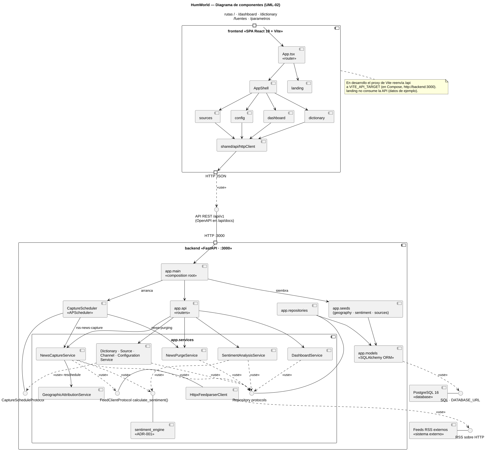

# UML-02 — Diagrama de componentes

| Campo | Valor |
|---|---|
| **Identificador** | `UML-02` |
| **Épica / Sprint** | Transversal — Sprint 3 (`DOC-S3`); rehecho en notación UML en el Sprint 4 (`DOC-04`) |
| **Responsable** | Matías Santos (Arquitectura y Documentación) |
| **Depende de** | `ADR-000` (tres capas), `ADR-001` (cálculo del humor), `ADR-003` (stack), `ADR-004` (frontend), `MOD-01` (modelo E/R) |
| **Estado** | Publicado — refleja `main` en `5e166a8` (3 de noviembre de 2026) |
| **Fecha** | 2026-11-04 |
| **Fuente** | Especificación HumWorld 260714, secc. 4.7 (punto 3); `backend/app/`, `frontend/src/`, `opsx/docker-compose.yml` |

---

## 1. Alcance

Diagrama de componentes UML 2 de HumWorld: componentes, puertos, interfaces provistas (círculo) e interfaces requeridas (dependencia `«use»`), tal como están en el código. Los nombres de los componentes son módulos o clases reales.

No incluye el detalle de entidades y atributos, que está en [`MOD-01`](MOD-01-modelo-er-inicial.md), ni el flujo de usuario, que está en [`UML-01`](UML-01-casos-de-uso.md).

---

## 2. Diagrama



Fuente PlantUML: [`UML-02-diagrama-componentes.puml`](UML-02-diagrama-componentes.puml). Para regenerar el SVG tras modificarla:

```bash
plantuml -tsvg docs/uml/UML-02-diagrama-componentes.puml
```

Notación:

| Elemento | Significado |
|---|---|
| Rectángulo con el icono de componente | Componente. Los anidados son sus partes internas. |
| Cuadrado en el borde | Puerto. `frontend` recibe las rutas del navegador y sale por HTTP; `backend` expone HTTP en `:3000`. |
| Círculo unido con línea continua | Interfaz provista por el componente al que está unida. |
| Flecha discontinua `«use»` | Interfaz requerida: el componente de origen depende de ella. |
| Flecha continua | Dependencia directa o delegación (quién llama a quién). |

---

## 3. Componentes

### 3.1 Frontend (`frontend/src`)

| Componente | Responsabilidad |
|---|---|
| `App.tsx` | Rutas: `/` (landing) y, dentro de `AppShell`, `/dashboard`, `/dictionary`, `/fuentes` y `/parametros`. Cualquier otra ruta redirige a `/dictionary`. |
| `components/AppShell` | Marco común con la navegación lateral. Las pantallas de `pages/` (código anterior a `ADR-004`) montan las funcionalidades. |
| `features/<funcionalidad>/` | Código según `ADR-004` (estado Propuesto): `domain`, `application` (hooks como `useDashboard`, `useSources`, `useConfig`), `infrastructure` (clientes `dashboardApi`, `dictionaryApi`, `sourcesApi`, `configApi`) y `presentation`. |
| `features/landing` | Landing pública con mapa de `react-simple-maps`. No consume la API (datos de ejemplo). |
| `features/dashboard` | `DashboardMap` (d3, d3-geo, topojson-client), `DashboardTimeline` y `DashboardSummary` (d3), y `DashboardWordCloud` (React sin bibliotecas de gráficos). |
| `shared/api/httpClient.ts` | Único cliente HTTP. Antepone `VITE_API_URL` (vacío por defecto) a las rutas `/api/v1/...`. |
| Proxy de Vite (`vite.config.ts`) | En desarrollo reenvía `/api` a `VITE_API_TARGET` (por defecto `http://localhost:3000`; en Compose, `http://backend:3000`). |

### 3.2 Backend (`backend/app`)

Las capas y sus reglas R-1 a R-6 son normativas (`ADR-000`): `api` → `services` → `repositories` → `models`, en un solo sentido y sin saltos.

| Componente | Responsabilidad |
|---|---|
| `main.py` | Raíz de composición. Crea la aplicación FastAPI, monta los siete routers bajo `/api/v1`, traduce las excepciones de dominio a `400`/`404` y los errores de validación a `400`, y publica `/api/docs` y `/api/openapi.json`. Su `lifespan` siembra la configuración y el léxico de sentimiento y arranca el scheduler, solo si `CAPTURE_SCHEDULER_ENABLED` es verdadero. |
| `app/api/*` | Routers sin reglas de negocio (`channels`, `configuration`, `dashboards`, `dictionary`, `news`, `sentiment`, `sources`); validan entrada con `schemas.py`, instancian el servicio con su repositorio y delegan. |
| `DictionaryService`, `SourceService`, `ChannelService`, `ConfigurationService` | Reglas de gestión del diccionario, fuentes, canales y parámetros. `ConfigurationService` reprograma el scheduler mediante `CaptureScheduleProtocol` tras `PUT /config`. |
| `DashboardService` | Valida el filtro y arma los agregados por continente, país y global, la evolución, la nube de palabras y las noticias influyentes (`ADR-002`). |
| `SentimentAnalysisService` | Análisis puntual de un texto (`POST /sentiment`), sin persistencia. |
| `NewsCaptureService` | Lee los feeds a través de `FeedClientProtocol` (implementado por `HttpxFeedparserClient`), inserta las noticias, calcula el humor y la atribución geográfica en la misma transacción por fuente, y procesa las pendientes (`process_pending_news()`). |
| `GeographicAttributionService` | Reconoce países mencionados en el texto con un reconocedor trie local sobre el catálogo sembrado. No consulta servicios externos. |
| `NewsPurgeService` | Borra las noticias más antiguas que `noticias_caducidad_dias`; lo usan el trabajo `news-purging` y `DELETE /news` (vía `NewsPurgeApplicationService`). |
| `sentiment_engine.py` | Motor de cálculo del humor (`ADR-001`): reconoce términos activos del idioma de la noticia y normaliza la puntuación a `[-1, 1]` con la fórmula configurada. No accede a la base de datos y se prueba sin ella. |
| `app/repositories/*` | Únicas clases que consultan PostgreSQL. Implementan los protocolos de repositorio que declaran los servicios. `DashboardRepository` ejecuta las consultas agregadas sobre `NOTICIA_PAIS/PAIS`. |
| `app/models/*` | Modelos SQLAlchemy de las tablas `canal`, `fuente_rss`, `noticia`, `termino`, `noticia_termino`, `configuracion`, `pais`, `pais_alias` y `noticia_pais`. |
| `scheduler.py` | `CaptureScheduler` sobre `BackgroundScheduler` de APScheduler (UTC). Dos trabajos con intervalo `captura_periodicidad_minutos`: `rss-news-capture` y `news-purging`. Exige un único proceso de uvicorn. |
| `app/seeds/` | `geography.py` (catálogo de países; se ejecuta al arrancar el contenedor), `sentiment.py` (parámetros y léxico; desde `lifespan`) y `sources.py` (seis canales; se ejecuta a mano). |
| `scripts/` (fuera del diagrama) | Herramientas offline: `generate_geographic_catalog.py` (REST Countries + GeoNames + overlay curado), `backfill_geography.py` (atribución por lotes de noticias existentes) y `benchmark_geographic_matcher.py`. |

### 3.3 Infraestructura

| Componente | Detalle |
|---|---|
| PostgreSQL 16 | Imagen `postgres:16-alpine`, puerto `5432`, volumen `postgres_data`. Único gestor admitido (`ADR-003`), también en pruebas. |
| Contenedor `backend` | `python:3.12-slim`; al arrancar ejecuta `alembic upgrade head`, `python -m app.seeds.geography` y uvicorn en el puerto `3000`. |
| Contenedor `frontend` | `node:22-alpine`; servidor de desarrollo de Vite en el puerto `5173`. |
| Feeds RSS externos | Fuente de las noticias. Solo lectura por RSS; sin *scraping*. |

---

## 4. Interfaces

| Interfaz | Proveedor | Consumidor | Operaciones |
|---|---|---|---|
| `/api/v1/dashboards` | `api/dashboards.py` | `features/dashboard` | `GET ""`, `GET /geografia`, `GET /evolucion`, `GET /nube-palabras`, `GET /noticias-influyentes` |
| `/api/v1/dictionary` | `api/dictionary.py` | `features/dictionary` | `GET`, `POST`; `GET`, `PUT`, `PATCH`, `DELETE /{term_id}` |
| `/api/v1/sources` | `api/sources.py` | `features/sources` | `GET`, `POST`; `GET`, `PUT`, `PATCH`, `DELETE /{source_id}`; `POST /capture` |
| `/api/v1/channels` | `api/channels.py` | `features/sources` | `GET`; `GET`, `PUT`, `PATCH`, `DELETE /{channel_id}` |
| `/api/v1/config` | `api/configuration.py` | `features/config` | `GET`, `PUT` |
| `/api/v1/news` | `api/news.py` | `features/config` | `DELETE` (purgado manual) |
| `/api/v1/sentiment` | `api/sentiment.py` | Ninguno en el frontend (Swagger o clientes externos) | `POST` |
| `/api/docs`, `/api/openapi.json` | `main.py` | Desarrolladores | Documentación OpenAPI; copia en [`docs/openapi/openapi.yaml`](../openapi/openapi.yaml) |
| `CaptureScheduleProtocol` | `CaptureScheduler` | `ConfigurationService` | `reschedule(minutos)` tras `PUT /config` |
| `FeedClientProtocol` | `HttpxFeedparserClient` | `NewsCaptureService` | Descarga y parseo de un feed |
| `calculate_sentiment(...)` | `sentiment_engine.py` | `NewsCaptureService`, `SentimentAnalysisService` | Cálculo en memoria, sin base de datos |
| Protocolos de repositorio (`*RepositoryProtocol`) | `app/repositories` | Servicios | Persistencia y consultas |
| SQL sobre `DATABASE_URL` | PostgreSQL 16 | `app/models` y repositorios (SQLAlchemy + psycopg) | Lectura y escritura de las nueve tablas |
| RSS sobre HTTP | Medios externos | `HttpxFeedparserClient` | Lectura de feeds (httpx + feedparser) |

---

## 5. Encaje con los ADR

- **ADR-000.** Los servicios dependen de protocolos de repositorio, no de las clases concretas; los repositorios los implementan. `main.py`, los routers y el scheduler actúan como raíz de composición: instancian servicios y repositorios, pero no contienen reglas de negocio.
- **ADR-001.** El motor de sentimiento es un componente de la capa de servicios que solo provee `calculate_sentiment(...)` y no depende de la base de datos.
- **ADR-002.** El orden y el límite de las noticias influyentes se ejecutan en `DashboardRepository`; el frontend no reordena.
- **ADR-004.** Convive con el código por tipo de `pages/`. Las funcionalidades (`dashboard`, `dictionary`, `sources`, `config`, `landing`) siguen la estructura por funcionalidad.

---

*Documento UML-02 — Proyecto HumWorld, Universidad Andrés Bello, curso Uso de IA en Ingeniería de Software 2026-27.*
